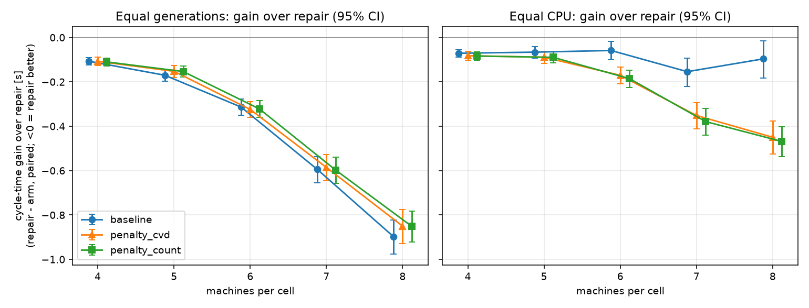

# Repair, the wall, and two penalties, by machine count

One `run_penalty_ab` study per machine count (pairs per study: 4 machines = 200, 5 machines = 200, 6 machines = 200, 7 machines = 200, 8 machines = 200). All four arms start from the identical population per (instance, seed). **Gain** is reference minus arm cycle time, so positive means the arm was faster than the reference. Holm corrects the permutation p-values within each table (all rows of the table are one family).

Cycle times are not comparable between rows (more machines, more stations); the gain within a row is.

## Mean cycle time (s), equal generations

| machines | `baseline` | `repair` | `penalty_cvd` | `penalty_count` |
|---:|---:|---:|---:|---:|
| 4 | 7.285 | **7.178** | 7.286 | 7.288 |
| 5 | 9.110 | **8.940** | 9.092 | 9.093 |
| 6 | 10.902 | **10.589** | 10.913 | 10.910 |
| 7 | 13.083 | **12.489** | 13.075 | 13.086 |
| 8 | 15.486 | **14.589** | 15.439 | 15.440 |

## Against `repair`, equal generations

| machines | arm | arm [s] | `repair` [s] | gain [s] | 95% CI | arm wins | p (Holm) |
|---:|---|---:|---:|---:|---|---:|---:|
| 4 | `baseline` | 7.285 | 7.178 | -0.107 | [-0.123, -0.091] | 36/200 | < 0.0001 |
| 4 | `penalty_cvd` | 7.286 | 7.178 | -0.108 | [-0.127, -0.089] | 38/200 | < 0.0001 |
| 4 | `penalty_count` | 7.288 | 7.178 | -0.110 | [-0.129, -0.092] | 42/200 | < 0.0001 |
| 5 | `baseline` | 9.110 | 8.940 | -0.170 | [-0.196, -0.146] | 30/200 | < 0.0001 |
| 5 | `penalty_cvd` | 9.092 | 8.940 | -0.152 | [-0.180, -0.126] | 42/200 | < 0.0001 |
| 5 | `penalty_count` | 9.093 | 8.940 | -0.153 | [-0.177, -0.129] | 29/200 | < 0.0001 |
| 6 | `baseline` | 10.902 | 10.589 | -0.313 | [-0.350, -0.278] | 14/200 | < 0.0001 |
| 6 | `penalty_cvd` | 10.913 | 10.589 | -0.324 | [-0.361, -0.290] | 14/200 | < 0.0001 |
| 6 | `penalty_count` | 10.910 | 10.589 | -0.322 | [-0.360, -0.285] | 17/200 | < 0.0001 |
| 7 | `baseline` | 13.083 | 12.489 | -0.594 | [-0.654, -0.537] | 9/200 | < 0.0001 |
| 7 | `penalty_cvd` | 13.075 | 12.489 | -0.586 | [-0.645, -0.527] | 8/200 | < 0.0001 |
| 7 | `penalty_count` | 13.086 | 12.489 | -0.597 | [-0.658, -0.538] | 6/200 | < 0.0001 |
| 8 | `baseline` | 15.486 | 14.589 | -0.897 | [-0.977, -0.821] | 6/200 | < 0.0001 |
| 8 | `penalty_cvd` | 15.439 | 14.589 | -0.850 | [-0.928, -0.775] | 6/200 | < 0.0001 |
| 8 | `penalty_count` | 15.440 | 14.589 | -0.851 | [-0.921, -0.782] | 5/200 | < 0.0001 |

## Penalty against the `+inf` wall, equal generations

| machines | arm | arm [s] | `baseline` [s] | gain [s] | 95% CI | arm wins | p (Holm) |
|---:|---|---:|---:|---:|---|---:|---:|
| 4 | `penalty_cvd` | 7.286 | 7.285 | -0.001 | [-0.020, +0.018] | 106/200 | 1.0000 |
| 4 | `penalty_count` | 7.288 | 7.285 | -0.003 | [-0.022, +0.014] | 101/200 | 1.0000 |
| 5 | `penalty_cvd` | 9.092 | 9.110 | +0.018 | [-0.008, +0.045] | 109/200 | 1.0000 |
| 5 | `penalty_count` | 9.093 | 9.110 | +0.017 | [-0.008, +0.043] | 111/200 | 1.0000 |
| 6 | `penalty_cvd` | 10.913 | 10.902 | -0.011 | [-0.051, +0.031] | 98/200 | 1.0000 |
| 6 | `penalty_count` | 10.910 | 10.902 | -0.008 | [-0.053, +0.037] | 93/200 | 1.0000 |
| 7 | `penalty_cvd` | 13.075 | 13.083 | +0.009 | [-0.050, +0.069] | 99/200 | 1.0000 |
| 7 | `penalty_count` | 13.086 | 13.083 | -0.003 | [-0.060, +0.053] | 102/200 | 1.0000 |
| 8 | `penalty_cvd` | 15.439 | 15.486 | +0.047 | [-0.038, +0.135] | 99/200 | 1.0000 |
| 8 | `penalty_count` | 15.440 | 15.486 | +0.046 | [-0.039, +0.133] | 108/200 | 1.0000 |

## Against `repair`, equal CPU

| machines | arm | arm [s] | `repair` [s] | gain [s] | 95% CI | arm wins | p (Holm) |
|---:|---|---:|---:|---:|---|---:|---:|
| 4 | `baseline` | 7.285 | 7.214 | -0.071 | [-0.088, -0.055] | 59/200 | < 0.0001 |
| 4 | `penalty_cvd` | 7.296 | 7.214 | -0.082 | [-0.102, -0.063] | 55/200 | < 0.0001 |
| 4 | `penalty_count` | 7.298 | 7.214 | -0.084 | [-0.103, -0.065] | 56/200 | < 0.0001 |
| 5 | `baseline` | 9.110 | 9.044 | -0.066 | [-0.093, -0.040] | 85/200 | < 0.0001 |
| 5 | `penalty_cvd` | 9.133 | 9.044 | -0.089 | [-0.117, -0.062] | 69/200 | < 0.0001 |
| 5 | `penalty_count` | 9.133 | 9.044 | -0.089 | [-0.114, -0.064] | 62/200 | < 0.0001 |
| 6 | `baseline` | 10.902 | 10.843 | -0.059 | [-0.101, -0.018] | 96/200 | 0.0119 |
| 6 | `penalty_cvd` | 11.014 | 10.843 | -0.171 | [-0.209, -0.134] | 49/200 | < 0.0001 |
| 6 | `penalty_count` | 11.029 | 10.843 | -0.185 | [-0.226, -0.146] | 48/200 | < 0.0001 |
| 7 | `baseline` | 13.083 | 12.929 | -0.154 | [-0.219, -0.092] | 79/200 | < 0.0001 |
| 7 | `penalty_cvd` | 13.281 | 12.929 | -0.352 | [-0.412, -0.293] | 32/200 | < 0.0001 |
| 7 | `penalty_count` | 13.308 | 12.929 | -0.379 | [-0.441, -0.320] | 30/200 | < 0.0001 |
| 8 | `baseline` | 15.486 | 15.390 | -0.096 | [-0.182, -0.016] | 99/200 | 0.0238 |
| 8 | `penalty_cvd` | 15.840 | 15.390 | -0.450 | [-0.525, -0.375] | 37/200 | < 0.0001 |
| 8 | `penalty_count` | 15.859 | 15.390 | -0.469 | [-0.537, -0.402] | 24/200 | < 0.0001 |

## Penalty against the `+inf` wall, equal CPU

| machines | arm | arm [s] | `baseline` [s] | gain [s] | 95% CI | arm wins | p (Holm) |
|---:|---|---:|---:|---:|---|---:|---:|
| 4 | `penalty_cvd` | 7.296 | 7.285 | -0.011 | [-0.030, +0.008] | 103/200 | 0.3639 |
| 4 | `penalty_count` | 7.298 | 7.285 | -0.013 | [-0.031, +0.005] | 98/200 | 0.3639 |
| 5 | `penalty_cvd` | 9.133 | 9.110 | -0.023 | [-0.050, +0.006] | 84/200 | 0.3639 |
| 5 | `penalty_count` | 9.133 | 9.110 | -0.023 | [-0.050, +0.004] | 90/200 | 0.3639 |
| 6 | `penalty_cvd` | 11.014 | 10.902 | -0.112 | [-0.157, -0.067] | 62/200 | < 0.0001 |
| 6 | `penalty_count` | 11.029 | 10.902 | -0.127 | [-0.177, -0.077] | 67/200 | < 0.0001 |
| 7 | `penalty_cvd` | 13.281 | 13.083 | -0.198 | [-0.260, -0.132] | 55/200 | < 0.0001 |
| 7 | `penalty_count` | 13.308 | 13.083 | -0.225 | [-0.286, -0.166] | 49/200 | < 0.0001 |
| 8 | `penalty_cvd` | 15.840 | 15.486 | -0.353 | [-0.443, -0.262] | 51/200 | < 0.0001 |
| 8 | `penalty_count` | 15.859 | 15.486 | -0.372 | [-0.464, -0.279] | 48/200 | < 0.0001 |

