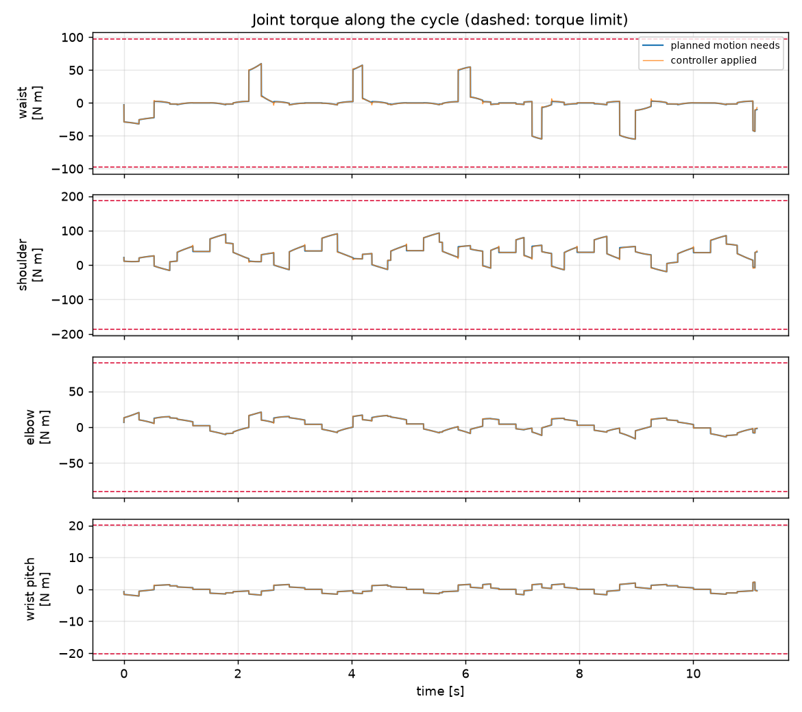
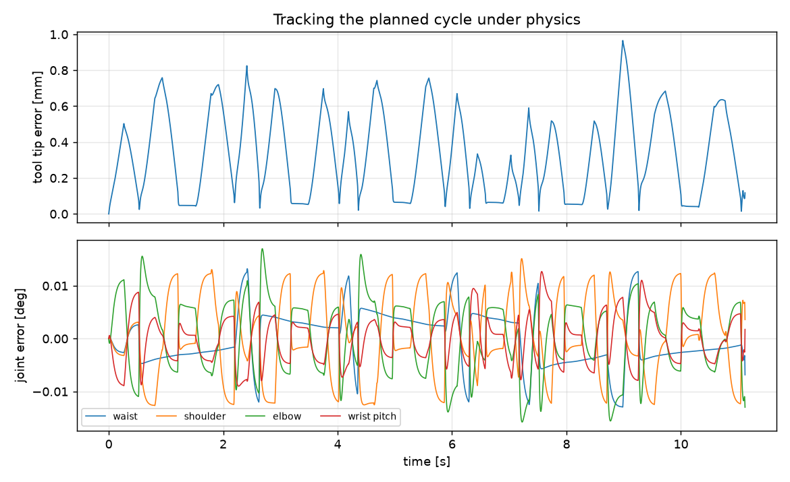

# MuJoCo check: `test_6` run 9 from `results/cx08_mut02_r20_g300`

Planned cycle 11.1203 s, posture right/down, retract 0.06 m.

## Clearance, solid arm vs machines

Worst gap along the cycle: **21.15 mm** (wrist to M5, t = 1.22 s). The evaluator's bounding spheres give 8.93 mm on the same samples; the spheres enclose the solid, so theirs should be the smaller number.

## Torque the planned motion needs

Inverse dynamics (Armstrong/Corke inertias, reflected motor inertia, viscous and Coulomb friction). Limits are the commonly quoted Puma 560 figures, **not verified against a Unimation document**.

| joint | peak [N m] | limit [N m] | use | at [s] |
|---|---:|---:|---:|---:|
| waist | 59.81 | 97.6 | 61% | 2.413 |
| shoulder | 93.01 | 186.4 | 50% | 5.539 |
| elbow | 20.97 | 89.4 | 24% | 2.413 |
| wrist roll | 0.01 | 24.2 | 0% | 8.983 |
| wrist pitch | 2.24 | 20.1 | 11% | 11.084 |
| flange roll | 0.0 | 21.3 | 0% | 2.485 |

## Tracking under physics

Computed-torque control at 25.0 rad/s, Coulomb feed-forward x1.0, torques clipped at the limits.

- Tool tip error: max **0.966 mm**, RMS 0.402 mm; at the stations max 0.060 mm.
- Collision steps outside the approach corridor: **0**.
- Gripper contact with the served machine's top: 7146 steps (expected: the tool tip is planned onto the top surface).

