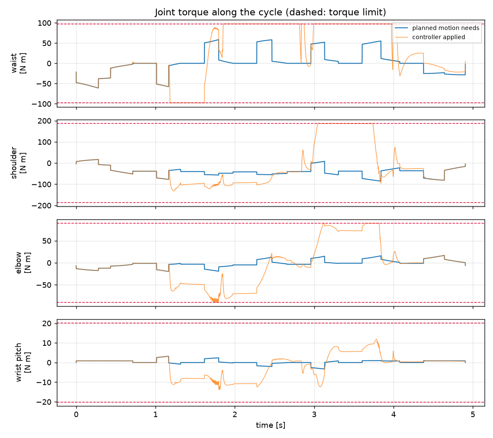
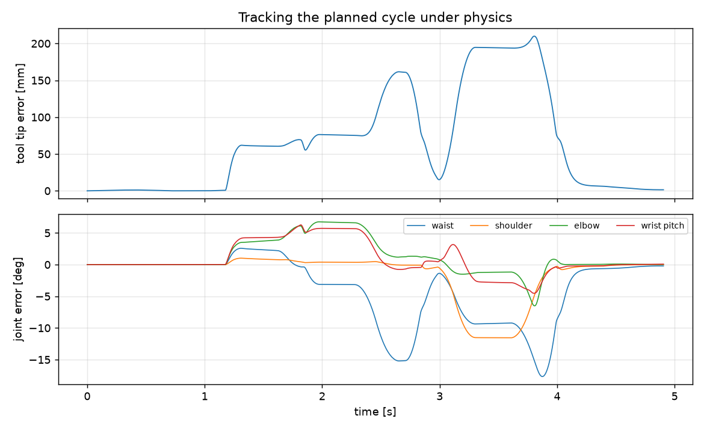

# MuJoCo check: `test_1` run 14 from `results/repair_equalcpu_noretract`

Planned cycle 4.9046 s, posture left/up, retract None m.

## Clearance, solid arm vs machines

Worst gap along the cycle: **-39.69 mm** (finger_b to M5, t = 3.9 s). The evaluator's bounding spheres give -51.14 mm on the same samples; the spheres enclose the solid, so theirs should be the smaller number.

## Torque the planned motion needs

Inverse dynamics (Armstrong/Corke inertias, reflected motor inertia, viscous and Coulomb friction). Limits are the commonly quoted Puma 560 figures, **not verified against a Unimation document**.

| joint | peak [N m] | limit [N m] | use | at [s] |
|---|---:|---:|---:|---:|
| waist | 61.04 | 97.6 | 62% | 0.28 |
| shoulder | 85.19 | 186.4 | 46% | 3.841 |
| elbow | 19.76 | 89.4 | 22% | 1.165 |
| wrist roll | 0.01 | 24.2 | 0% | 0.434 |
| wrist pitch | 3.28 | 20.1 | 16% | 3.131 |
| flange roll | 0.0 | 21.3 | 0% | 2.422 |

## Tracking under physics

Computed-torque control at 25.0 rad/s, Coulomb feed-forward x1.0, torques clipped at the limits.

- Tool tip error: max **209.972 mm**, RMS 94.338 mm; at the stations max 193.708 mm.
- Collision steps outside the approach corridor: **1575** (finger_a / M1, finger_b / M3, finger_b / M5, finger_b / M6, palm / M6).
- Gripper contact with the served machine's top: 4376 steps (expected: the tool tip is planned onto the top surface).

