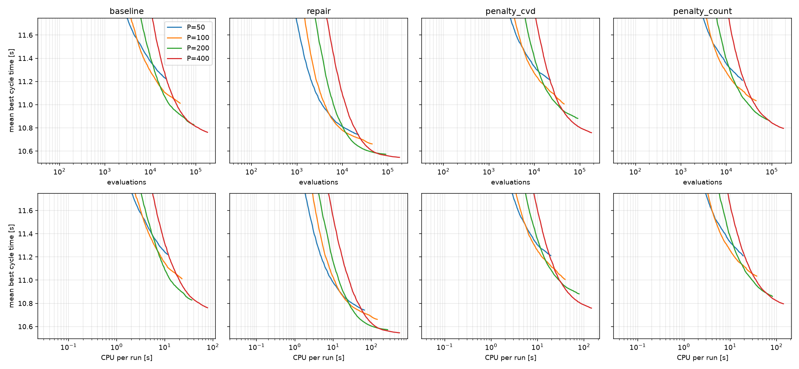

# Population size x generations, four constraint handlers

One `run_penalty_ab` study per population size, run to 500 generations and read at every cut from the per-generation traces (nothing in the GA depends on the configured generation count, so the cut *is* the shorter run). Sets per population: P=50: 100, P=100: 100, P=200: 100, P=400: 100. Retract model on, crossover 0.8, mutation 0.2, elitism 10%, tournament k=3. Cells are mean best cycle time (s) over feasible runs; **bold** is the best cell of the table.

## Equal generations

**`baseline`**

| P \ G | 25 | 50 | 100 | 150 | 200 | 300 | 400 | 500 |
|---:|---:|---:|---:|---:|---:|---:|---:|---:|
| 50 | 12.477 | 11.931 | 11.594 | 11.478 | 11.398 | 11.304 | 11.252 | 11.221 |
| 100 | 12.184 | 11.641 | 11.318 | 11.205 | 11.134 | 11.072 | 11.040 | 11.012 |
| 200 | 12.053 | 11.477 | 11.119 | 10.993 | 10.945 | 10.891 | 10.846 | 10.829 |
| 400 | 11.961 | 11.351 | 11.017 | 10.903 | 10.850 | 10.805 | 10.778 | **10.762** |

**`repair`**

| P \ G | 25 | 50 | 100 | 150 | 200 | 300 | 400 | 500 |
|---:|---:|---:|---:|---:|---:|---:|---:|---:|
| 50 | 11.612 | 11.164 | 10.949 | 10.862 | 10.823 | 10.783 | 10.756 | 10.742 |
| 100 | 11.337 | 10.961 | 10.795 | 10.748 | 10.725 | 10.701 | 10.674 | 10.662 |
| 200 | 11.220 | 10.850 | 10.670 | 10.623 | 10.603 | 10.584 | 10.577 | 10.573 |
| 400 | 11.154 | 10.808 | 10.632 | 10.585 | 10.569 | 10.557 | 10.550 | **10.546** |

**`penalty_cvd`**

| P \ G | 25 | 50 | 100 | 150 | 200 | 300 | 400 | 500 |
|---:|---:|---:|---:|---:|---:|---:|---:|---:|
| 50 | 12.476 | 11.896 | 11.551 | 11.428 | 11.351 | 11.271 | 11.239 | 11.212 |
| 100 | 12.161 | 11.604 | 11.301 | 11.199 | 11.154 | 11.090 | 11.041 | 11.006 |
| 200 | 12.070 | 11.469 | 11.130 | 11.031 | 10.977 | 10.924 | 10.901 | 10.881 |
| 400 | 11.937 | 11.334 | 10.993 | 10.891 | 10.844 | 10.795 | 10.775 | **10.759** |

**`penalty_count`**

| P \ G | 25 | 50 | 100 | 150 | 200 | 300 | 400 | 500 |
|---:|---:|---:|---:|---:|---:|---:|---:|---:|
| 50 | 12.466 | 11.913 | 11.579 | 11.456 | 11.385 | 11.295 | 11.244 | 11.210 |
| 100 | 12.194 | 11.594 | 11.309 | 11.204 | 11.151 | 11.088 | 11.053 | 11.034 |
| 200 | 12.056 | 11.455 | 11.137 | 11.028 | 10.970 | 10.907 | 10.880 | 10.860 |
| 400 | 11.942 | 11.380 | 11.050 | 10.939 | 10.889 | 10.836 | 10.809 | **10.796** |

## Equal evaluations (P x G fixed)

**`baseline`**

| P \ evals | 5000 | 10000 | 20000 | 40000 | 80000 |
|---:|---:|---:|---:|---:|---:|
| 50 | 11.567 | 11.371 | 11.236 | -- | -- |
| 100 | 11.576 | 11.287 | 11.110 | 11.026 | -- |
| 200 | 11.958 | 11.407 | 11.080 | 10.930 | 10.837 |
| 400 | 12.616 | 11.882 | 11.292 | 10.980 | **10.836** |

**`repair`**

| P \ evals | 5000 | 10000 | 20000 | 40000 | 80000 |
|---:|---:|---:|---:|---:|---:|
| 50 | 10.923 | 10.811 | 10.749 | -- | -- |
| 100 | 10.928 | 10.778 | 10.718 | 10.667 | -- |
| 200 | 11.160 | 10.815 | 10.656 | 10.597 | 10.575 |
| 400 | 11.711 | 11.107 | 10.780 | 10.617 | **10.566** |

**`penalty_cvd`**

| P \ evals | 5000 | 10000 | 20000 | 40000 | 80000 |
|---:|---:|---:|---:|---:|---:|
| 50 | 11.520 | 11.327 | 11.224 | -- | -- |
| 100 | 11.545 | 11.269 | 11.134 | 11.022 | -- |
| 200 | 11.980 | 11.408 | 11.104 | 10.958 | 10.891 |
| 400 | 12.622 | 11.837 | 11.272 | 10.965 | **10.829** |

**`penalty_count`**

| P \ evals | 5000 | 10000 | 20000 | 40000 | 80000 |
|---:|---:|---:|---:|---:|---:|
| 50 | 11.535 | 11.353 | 11.231 | -- | -- |
| 100 | 11.537 | 11.280 | 11.137 | 11.043 | -- |
| 200 | 11.965 | 11.395 | 11.103 | 10.950 | **10.870** |
| 400 | 12.631 | 11.876 | 11.316 | 11.016 | 10.874 |

## Equal CPU per run

**`baseline`**

| P \ CPU s | 5 | 10 | 20 | 40 | 80 |
|---:|---:|---:|---:|---:|---:|
| 50 | 11.408 | -- | -- | -- | -- |
| 100 | 11.367 | 11.146 | -- | -- | -- |
| 200 | 11.443 | 11.087 | 10.921 | -- | -- |
| 400 | 11.854 | 11.310 | 10.992 | **10.830** | -- |

**`repair`**

| P \ CPU s | 5 | 10 | 20 | 40 | 80 |
|---:|---:|---:|---:|---:|---:|
| 50 | 11.179 | 10.975 | 10.846 | 10.777 | -- |
| 100 | 11.334 | 11.018 | 10.838 | 10.752 | 10.703 |
| 200 | 11.617 | 11.168 | 10.875 | 10.698 | **10.618** |
| 400 | 12.134 | 11.568 | 11.115 | 10.834 | 10.663 |

**`penalty_cvd`**

| P \ CPU s | 5 | 10 | 20 | 40 | 80 |
|---:|---:|---:|---:|---:|---:|
| 50 | 11.503 | 11.299 | -- | -- | -- |
| 100 | 11.517 | 11.252 | 11.118 | -- | -- |
| 200 | 11.833 | 11.348 | 11.078 | 10.945 | -- |
| 400 | 12.282 | 11.599 | 11.159 | 10.922 | **10.805** |

**`penalty_count`**

| P \ CPU s | 5 | 10 | 20 | 40 | 80 |
|---:|---:|---:|---:|---:|---:|
| 50 | 11.525 | 11.334 | -- | -- | -- |
| 100 | 11.498 | 11.255 | 11.117 | -- | -- |
| 200 | 11.873 | 11.375 | 11.098 | 10.943 | -- |
| 400 | 12.300 | 11.650 | 11.217 | 10.973 | **10.844** |

## CPU per run (s), equal generations

**`baseline`**

| P \ G | 25 | 50 | 100 | 150 | 200 | 300 | 400 | 500 |
|---:|---:|---:|---:|---:|---:|---:|---:|---:|
| 50 | 0.7 | 1.6 | 3.0 | 4.2 | 5.3 | 7.5 | 9.5 | 11.5 |
| 100 | 1.4 | 3.0 | 5.8 | 8.2 | 10.5 | 14.8 | 18.8 | 22.7 |
| 200 | 2.3 | 4.8 | 9.4 | 13.4 | 17.0 | 23.8 | 30.3 | 36.5 |
| 400 | 4.4 | 9.5 | 19.1 | 27.8 | 35.7 | 50.4 | 64.0 | 77.1 |

**`repair`**

| P \ G | 25 | 50 | 100 | 150 | 200 | 300 | 400 | 500 |
|---:|---:|---:|---:|---:|---:|---:|---:|---:|
| 50 | 2.3 | 5.3 | 11.8 | 18.3 | 25.1 | 38.4 | 51.6 | 65.0 |
| 100 | 5.0 | 12.0 | 26.4 | 41.1 | 55.4 | 83.8 | 112.5 | 141.3 |
| 200 | 9.0 | 21.6 | 48.2 | 75.0 | 101.8 | 155.7 | 209.7 | 263.5 |
| 400 | 18.6 | 43.8 | 97.9 | 152.7 | 207.3 | 316.9 | 427.5 | 537.3 |

**`penalty_cvd`**

| P \ G | 25 | 50 | 100 | 150 | 200 | 300 | 400 | 500 |
|---:|---:|---:|---:|---:|---:|---:|---:|---:|
| 50 | 1.0 | 2.1 | 4.3 | 6.3 | 8.2 | 11.9 | 15.6 | 19.2 |
| 100 | 2.0 | 4.3 | 8.5 | 12.5 | 16.4 | 23.9 | 31.4 | 38.9 |
| 200 | 3.9 | 8.1 | 16.5 | 24.6 | 32.4 | 47.7 | 62.8 | 77.9 |
| 400 | 6.9 | 14.6 | 30.2 | 45.2 | 59.7 | 88.2 | 116.3 | 144.1 |

**`penalty_count`**

| P \ G | 25 | 50 | 100 | 150 | 200 | 300 | 400 | 500 |
|---:|---:|---:|---:|---:|---:|---:|---:|---:|
| 50 | 1.0 | 2.1 | 4.2 | 6.2 | 8.1 | 11.8 | 15.4 | 19.0 |
| 100 | 2.0 | 4.1 | 8.2 | 12.1 | 15.9 | 23.2 | 30.3 | 37.3 |
| 200 | 4.1 | 8.7 | 17.6 | 26.1 | 34.2 | 50.2 | 65.9 | 81.5 |
| 400 | 6.9 | 14.8 | 30.4 | 45.3 | 59.6 | 87.3 | 114.2 | 140.8 |

## Is repair's lead stable across the grid? (equal generations)

Gain = other arm minus repair, paired by (instance, seed); positive means repair faster. Holm over every cell of the table.

| P | G | vs | gain [s] | 95% CI | repair wins | p (Holm) |
|---:|---:|---|---:|---|---:|---:|
| 50 | 25 | `baseline` | +0.865 | [+0.770, +0.960] | 96/100 | 0.0005 |
| 50 | 25 | `penalty_cvd` | +0.864 | [+0.778, +0.950] | 97/100 | 0.0005 |
| 50 | 25 | `penalty_count` | +0.853 | [+0.766, +0.942] | 99/100 | 0.0005 |
| 50 | 50 | `baseline` | +0.767 | [+0.684, +0.854] | 99/100 | 0.0005 |
| 50 | 50 | `penalty_cvd` | +0.732 | [+0.650, +0.817] | 97/100 | 0.0005 |
| 50 | 50 | `penalty_count` | +0.748 | [+0.662, +0.840] | 97/100 | 0.0005 |
| 50 | 100 | `baseline` | +0.644 | [+0.568, +0.730] | 99/100 | 0.0005 |
| 50 | 100 | `penalty_cvd` | +0.601 | [+0.521, +0.686] | 96/100 | 0.0005 |
| 50 | 100 | `penalty_count` | +0.630 | [+0.541, +0.727] | 93/100 | 0.0005 |
| 50 | 150 | `baseline` | +0.616 | [+0.538, +0.700] | 99/100 | 0.0005 |
| 50 | 150 | `penalty_cvd` | +0.566 | [+0.489, +0.646] | 98/100 | 0.0005 |
| 50 | 150 | `penalty_count` | +0.594 | [+0.505, +0.691] | 95/100 | 0.0005 |
| 50 | 200 | `baseline` | +0.575 | [+0.494, +0.662] | 99/100 | 0.0005 |
| 50 | 200 | `penalty_cvd` | +0.528 | [+0.448, +0.613] | 97/100 | 0.0005 |
| 50 | 200 | `penalty_count` | +0.562 | [+0.472, +0.662] | 95/100 | 0.0005 |
| 50 | 300 | `baseline` | +0.522 | [+0.443, +0.604] | 94/100 | 0.0005 |
| 50 | 300 | `penalty_cvd` | +0.489 | [+0.405, +0.575] | 95/100 | 0.0005 |
| 50 | 300 | `penalty_count` | +0.512 | [+0.423, +0.610] | 96/100 | 0.0005 |
| 50 | 400 | `baseline` | +0.496 | [+0.417, +0.581] | 94/100 | 0.0005 |
| 50 | 400 | `penalty_cvd` | +0.483 | [+0.398, +0.572] | 95/100 | 0.0005 |
| 50 | 400 | `penalty_count` | +0.488 | [+0.400, +0.586] | 96/100 | 0.0005 |
| 50 | 500 | `baseline` | +0.479 | [+0.398, +0.566] | 91/100 | 0.0005 |
| 50 | 500 | `penalty_cvd` | +0.470 | [+0.384, +0.561] | 93/100 | 0.0005 |
| 50 | 500 | `penalty_count` | +0.468 | [+0.381, +0.566] | 94/100 | 0.0005 |
| 100 | 25 | `baseline` | +0.847 | [+0.770, +0.930] | 100/100 | 0.0005 |
| 100 | 25 | `penalty_cvd` | +0.824 | [+0.748, +0.903] | 98/100 | 0.0005 |
| 100 | 25 | `penalty_count` | +0.857 | [+0.779, +0.939] | 100/100 | 0.0005 |
| 100 | 50 | `baseline` | +0.679 | [+0.613, +0.746] | 100/100 | 0.0005 |
| 100 | 50 | `penalty_cvd` | +0.643 | [+0.584, +0.702] | 98/100 | 0.0005 |
| 100 | 50 | `penalty_count` | +0.633 | [+0.568, +0.697] | 99/100 | 0.0005 |
| 100 | 100 | `baseline` | +0.523 | [+0.459, +0.589] | 97/100 | 0.0005 |
| 100 | 100 | `penalty_cvd` | +0.506 | [+0.437, +0.576] | 95/100 | 0.0005 |
| 100 | 100 | `penalty_count` | +0.514 | [+0.444, +0.585] | 94/100 | 0.0005 |
| 100 | 150 | `baseline` | +0.456 | [+0.393, +0.524] | 94/100 | 0.0005 |
| 100 | 150 | `penalty_cvd` | +0.451 | [+0.377, +0.524] | 92/100 | 0.0005 |
| 100 | 150 | `penalty_count` | +0.456 | [+0.386, +0.526] | 90/100 | 0.0005 |
| 100 | 200 | `baseline` | +0.409 | [+0.346, +0.475] | 92/100 | 0.0005 |
| 100 | 200 | `penalty_cvd` | +0.429 | [+0.355, +0.504] | 90/100 | 0.0005 |
| 100 | 200 | `penalty_count` | +0.426 | [+0.356, +0.497] | 91/100 | 0.0005 |
| 100 | 300 | `baseline` | +0.371 | [+0.310, +0.437] | 91/100 | 0.0005 |
| 100 | 300 | `penalty_cvd` | +0.389 | [+0.316, +0.464] | 87/100 | 0.0005 |
| 100 | 300 | `penalty_count` | +0.388 | [+0.316, +0.460] | 89/100 | 0.0005 |
| 100 | 400 | `baseline` | +0.366 | [+0.304, +0.433] | 91/100 | 0.0005 |
| 100 | 400 | `penalty_cvd` | +0.367 | [+0.295, +0.440] | 87/100 | 0.0005 |
| 100 | 400 | `penalty_count` | +0.379 | [+0.309, +0.451] | 89/100 | 0.0005 |
| 100 | 500 | `baseline` | +0.350 | [+0.288, +0.418] | 92/100 | 0.0005 |
| 100 | 500 | `penalty_cvd` | +0.344 | [+0.275, +0.416] | 84/100 | 0.0005 |
| 100 | 500 | `penalty_count` | +0.373 | [+0.302, +0.444] | 87/100 | 0.0005 |
| 200 | 25 | `baseline` | +0.834 | [+0.781, +0.885] | 100/100 | 0.0005 |
| 200 | 25 | `penalty_cvd` | +0.851 | [+0.802, +0.901] | 100/100 | 0.0005 |
| 200 | 25 | `penalty_count` | +0.836 | [+0.780, +0.893] | 99/100 | 0.0005 |
| 200 | 50 | `baseline` | +0.627 | [+0.581, +0.673] | 100/100 | 0.0005 |
| 200 | 50 | `penalty_cvd` | +0.619 | [+0.575, +0.668] | 100/100 | 0.0005 |
| 200 | 50 | `penalty_count` | +0.604 | [+0.555, +0.658] | 100/100 | 0.0005 |
| 200 | 100 | `baseline` | +0.449 | [+0.398, +0.501] | 100/100 | 0.0005 |
| 200 | 100 | `penalty_cvd` | +0.461 | [+0.412, +0.512] | 97/100 | 0.0005 |
| 200 | 100 | `penalty_count` | +0.468 | [+0.417, +0.522] | 100/100 | 0.0005 |
| 200 | 150 | `baseline` | +0.371 | [+0.321, +0.422] | 98/100 | 0.0005 |
| 200 | 150 | `penalty_cvd` | +0.408 | [+0.360, +0.459] | 96/100 | 0.0005 |
| 200 | 150 | `penalty_count` | +0.405 | [+0.353, +0.462] | 98/100 | 0.0005 |
| 200 | 200 | `baseline` | +0.342 | [+0.294, +0.392] | 96/100 | 0.0005 |
| 200 | 200 | `penalty_cvd` | +0.374 | [+0.328, +0.422] | 96/100 | 0.0005 |
| 200 | 200 | `penalty_count` | +0.367 | [+0.315, +0.425] | 98/100 | 0.0005 |
| 200 | 300 | `baseline` | +0.306 | [+0.259, +0.356] | 94/100 | 0.0005 |
| 200 | 300 | `penalty_cvd` | +0.340 | [+0.292, +0.390] | 94/100 | 0.0005 |
| 200 | 300 | `penalty_count` | +0.323 | [+0.271, +0.380] | 92/100 | 0.0005 |
| 200 | 400 | `baseline` | +0.269 | [+0.223, +0.317] | 91/100 | 0.0005 |
| 200 | 400 | `penalty_cvd` | +0.324 | [+0.274, +0.376] | 94/100 | 0.0005 |
| 200 | 400 | `penalty_count` | +0.303 | [+0.249, +0.361] | 93/100 | 0.0005 |
| 200 | 500 | `baseline` | +0.256 | [+0.210, +0.305] | 90/100 | 0.0005 |
| 200 | 500 | `penalty_cvd` | +0.309 | [+0.260, +0.361] | 93/100 | 0.0005 |
| 200 | 500 | `penalty_count` | +0.287 | [+0.235, +0.343] | 91/100 | 0.0005 |
| 400 | 25 | `baseline` | +0.807 | [+0.762, +0.852] | 100/100 | 0.0005 |
| 400 | 25 | `penalty_cvd` | +0.783 | [+0.734, +0.833] | 100/100 | 0.0005 |
| 400 | 25 | `penalty_count` | +0.788 | [+0.739, +0.837] | 100/100 | 0.0005 |
| 400 | 50 | `baseline` | +0.543 | [+0.500, +0.587] | 100/100 | 0.0005 |
| 400 | 50 | `penalty_cvd` | +0.526 | [+0.480, +0.573] | 99/100 | 0.0005 |
| 400 | 50 | `penalty_count` | +0.572 | [+0.530, +0.615] | 100/100 | 0.0005 |
| 400 | 100 | `baseline` | +0.385 | [+0.343, +0.428] | 99/100 | 0.0005 |
| 400 | 100 | `penalty_cvd` | +0.361 | [+0.315, +0.407] | 96/100 | 0.0005 |
| 400 | 100 | `penalty_count` | +0.417 | [+0.371, +0.465] | 99/100 | 0.0005 |
| 400 | 150 | `baseline` | +0.317 | [+0.277, +0.360] | 98/100 | 0.0005 |
| 400 | 150 | `penalty_cvd` | +0.305 | [+0.266, +0.346] | 97/100 | 0.0005 |
| 400 | 150 | `penalty_count` | +0.354 | [+0.307, +0.401] | 96/100 | 0.0005 |
| 400 | 200 | `baseline` | +0.280 | [+0.240, +0.323] | 97/100 | 0.0005 |
| 400 | 200 | `penalty_cvd` | +0.274 | [+0.235, +0.316] | 94/100 | 0.0005 |
| 400 | 200 | `penalty_count` | +0.320 | [+0.273, +0.368] | 94/100 | 0.0005 |
| 400 | 300 | `baseline` | +0.248 | [+0.209, +0.290] | 94/100 | 0.0005 |
| 400 | 300 | `penalty_cvd` | +0.238 | [+0.199, +0.280] | 93/100 | 0.0005 |
| 400 | 300 | `penalty_count` | +0.279 | [+0.232, +0.327] | 93/100 | 0.0005 |
| 400 | 400 | `baseline` | +0.228 | [+0.189, +0.269] | 90/100 | 0.0005 |
| 400 | 400 | `penalty_cvd` | +0.225 | [+0.185, +0.267] | 90/100 | 0.0005 |
| 400 | 400 | `penalty_count` | +0.259 | [+0.213, +0.308] | 93/100 | 0.0005 |
| 400 | 500 | `baseline` | +0.216 | [+0.178, +0.257] | 88/100 | 0.0005 |
| 400 | 500 | `penalty_cvd` | +0.213 | [+0.173, +0.255] | 87/100 | 0.0005 |
| 400 | 500 | `penalty_count` | +0.250 | [+0.204, +0.298] | 92/100 | 0.0005 |

## Population size at equal evaluations, against P=200

Gain = P=200 minus P, paired by (instance, seed); positive means the population size beat P=200 for the same number of evaluations.

| arm | evals | P | gain [s] | 95% CI | wins | p |
|---|---:|---:|---:|---|---:|---:|
| `baseline` | 5,000 | 50 | +0.392 | [+0.281, +0.489] | 85/100 | < 0.0001 |
| `baseline` | 5,000 | 100 | +0.382 | [+0.290, +0.468] | 82/100 | < 0.0001 |
| `baseline` | 5,000 | 400 | -0.657 | [-0.718, -0.597] | 1/100 | < 0.0001 |
| `baseline` | 10,000 | 50 | +0.036 | [-0.078, +0.143] | 62/100 | 0.5285 |
| `baseline` | 10,000 | 100 | +0.120 | [+0.028, +0.203] | 65/100 | 0.0073 |
| `baseline` | 10,000 | 400 | -0.474 | [-0.538, -0.411] | 7/100 | < 0.0001 |
| `baseline` | 20,000 | 50 | -0.156 | [-0.270, -0.047] | 44/100 | 0.0064 |
| `baseline` | 20,000 | 100 | -0.030 | [-0.124, +0.053] | 50/100 | 0.5164 |
| `baseline` | 20,000 | 400 | -0.212 | [-0.277, -0.145] | 27/100 | < 0.0001 |
| `baseline` | 40,000 | 100 | -0.096 | [-0.191, -0.009] | 43/100 | 0.0387 |
| `baseline` | 40,000 | 400 | -0.050 | [-0.115, +0.016] | 38/100 | 0.1383 |
| `baseline` | 80,000 | 400 | +0.001 | [-0.061, +0.063] | 45/100 | 0.9869 |
| `repair` | 5,000 | 50 | +0.236 | [+0.173, +0.295] | 88/100 | < 0.0001 |
| `repair` | 5,000 | 100 | +0.232 | [+0.175, +0.282] | 86/100 | < 0.0001 |
| `repair` | 5,000 | 400 | -0.551 | [-0.602, -0.502] | 1/100 | < 0.0001 |
| `repair` | 10,000 | 50 | +0.004 | [-0.054, +0.057] | 59/100 | 0.8806 |
| `repair` | 10,000 | 100 | +0.037 | [-0.016, +0.083] | 67/100 | 0.1451 |
| `repair` | 10,000 | 400 | -0.292 | [-0.321, -0.263] | 1/100 | < 0.0001 |
| `repair` | 20,000 | 50 | -0.093 | [-0.147, -0.046] | 40/100 | < 0.0001 |
| `repair` | 20,000 | 100 | -0.062 | [-0.114, -0.018] | 41/100 | 0.0097 |
| `repair` | 20,000 | 400 | -0.124 | [-0.152, -0.097] | 18/100 | < 0.0001 |
| `repair` | 40,000 | 100 | -0.070 | [-0.115, -0.032] | 39/100 | 0.0002 |
| `repair` | 40,000 | 400 | -0.020 | [-0.045, +0.005] | 45/100 | 0.1162 |
| `repair` | 80,000 | 400 | +0.009 | [-0.014, +0.032] | 51/100 | 0.4440 |
| `penalty_cvd` | 5,000 | 50 | +0.460 | [+0.363, +0.550] | 87/100 | < 0.0001 |
| `penalty_cvd` | 5,000 | 100 | +0.435 | [+0.362, +0.507] | 89/100 | < 0.0001 |
| `penalty_cvd` | 5,000 | 400 | -0.643 | [-0.713, -0.574] | 4/100 | < 0.0001 |
| `penalty_cvd` | 10,000 | 50 | +0.082 | [-0.020, +0.178] | 71/100 | 0.1106 |
| `penalty_cvd` | 10,000 | 100 | +0.140 | [+0.055, +0.222] | 73/100 | 0.0010 |
| `penalty_cvd` | 10,000 | 400 | -0.429 | [-0.490, -0.366] | 7/100 | < 0.0001 |
| `penalty_cvd` | 20,000 | 50 | -0.121 | [-0.226, -0.023] | 46/100 | 0.0215 |
| `penalty_cvd` | 20,000 | 100 | -0.030 | [-0.120, +0.057] | 51/100 | 0.5023 |
| `penalty_cvd` | 20,000 | 400 | -0.168 | [-0.232, -0.102] | 27/100 | < 0.0001 |
| `penalty_cvd` | 40,000 | 100 | -0.063 | [-0.153, +0.022] | 49/100 | 0.1559 |
| `penalty_cvd` | 40,000 | 400 | -0.007 | [-0.070, +0.057] | 49/100 | 0.8423 |
| `penalty_cvd` | 80,000 | 400 | +0.062 | [-0.000, +0.125] | 58/100 | 0.0568 |
| `penalty_count` | 5,000 | 50 | +0.430 | [+0.330, +0.528] | 86/100 | < 0.0001 |
| `penalty_count` | 5,000 | 100 | +0.427 | [+0.345, +0.506] | 88/100 | < 0.0001 |
| `penalty_count` | 5,000 | 400 | -0.666 | [-0.742, -0.588] | 6/100 | < 0.0001 |
| `penalty_count` | 10,000 | 50 | +0.042 | [-0.060, +0.140] | 58/100 | 0.4217 |
| `penalty_count` | 10,000 | 100 | +0.114 | [+0.030, +0.194] | 64/100 | 0.0069 |
| `penalty_count` | 10,000 | 400 | -0.481 | [-0.541, -0.420] | 6/100 | < 0.0001 |
| `penalty_count` | 20,000 | 50 | -0.128 | [-0.236, -0.026] | 41/100 | 0.0169 |
| `penalty_count` | 20,000 | 100 | -0.034 | [-0.121, +0.048] | 48/100 | 0.4356 |
| `penalty_count` | 20,000 | 400 | -0.213 | [-0.275, -0.150] | 27/100 | < 0.0001 |
| `penalty_count` | 40,000 | 100 | -0.093 | [-0.183, -0.009] | 43/100 | 0.0358 |
| `penalty_count` | 40,000 | 400 | -0.066 | [-0.136, +0.006] | 45/100 | 0.0708 |
| `penalty_count` | 80,000 | 400 | -0.004 | [-0.078, +0.073] | 46/100 | 0.9196 |

## Cheapest setting within 0.02 s of each arm's best

| arm | best (P, G) | best [s] | cheapest within tolerance | its time [s] | its CPU [s] |
|---|---|---:|---|---:|---:|
| `baseline` | (400, 500) | 10.762 | (400, 400) | 10.778 | 64.0 |
| `repair` | (400, 500) | 10.546 | (400, 300) | 10.557 | 316.9 |
| `penalty_cvd` | (400, 500) | 10.759 | (400, 400) | 10.775 | 116.3 |
| `penalty_count` | (400, 500) | 10.796 | (400, 400) | 10.809 | 114.2 |

