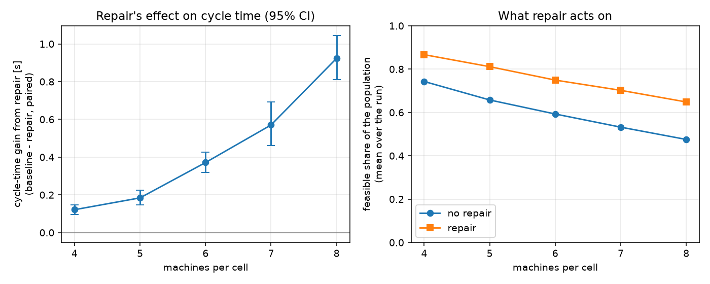

# Placement repair vs none, by machine count (retract on)

One paired study per row: 10 test instances x 10 seeds, both arms started from the identical population (fingerprint-checked). **Gain** is baseline minus repair cycle time over pairs where both found a layout, so positive means repair was faster. Holm corrects the permutation p-values across the rows.

Cycle times are not comparable between rows (more machines, more stations); the gain within a row is.

| machines | pairs | both feasible | only base / only repair | baseline [s] | repair [s] | gain [s] | 95% CI | repair wins | p (Holm) |
|---:|---:|---:|---:|---:|---:|---:|---|---:|---:|
| 4 | 100 | 100 | 0 / 0 | 7.319 | 7.198 | +0.121 | [+0.097, +0.147] | 85/100 | < 0.0001 |
| 5 | 100 | 100 | 0 / 0 | 9.148 | 8.964 | +0.184 | [+0.146, +0.224] | 85/100 | < 0.0001 |
| 6 | 100 | 100 | 0 / 0 | 10.993 | 10.622 | +0.371 | [+0.318, +0.426] | 96/100 | < 0.0001 |
| 7 | 100 | 100 | 0 / 0 | 13.113 | 12.543 | +0.570 | [+0.461, +0.692] | 89/100 | < 0.0001 |
| 8 | 100 | 100 | 0 / 0 | 15.523 | 14.600 | +0.923 | [+0.811, +1.044] | 97/100 | < 0.0001 |

| machines | population feasible share, base -> repair | diversity, base -> repair | CPU per run [s], base -> repair |
|---:|---|---|---|
| 4 | 0.743 -> 0.867 | 16.42 -> 16.18 | 218 -> 284 |
| 5 | 0.658 -> 0.811 | 17.49 -> 17.19 | 252 -> 379 |
| 6 | 0.593 -> 0.749 | 18.44 -> 17.99 | 274 -> 466 |
| 7 | 0.532 -> 0.702 | 19.78 -> 19.12 | 305 -> 552 |
| 8 | 0.475 -> 0.648 | 20.73 -> 20.41 | 301 -> 594 |

